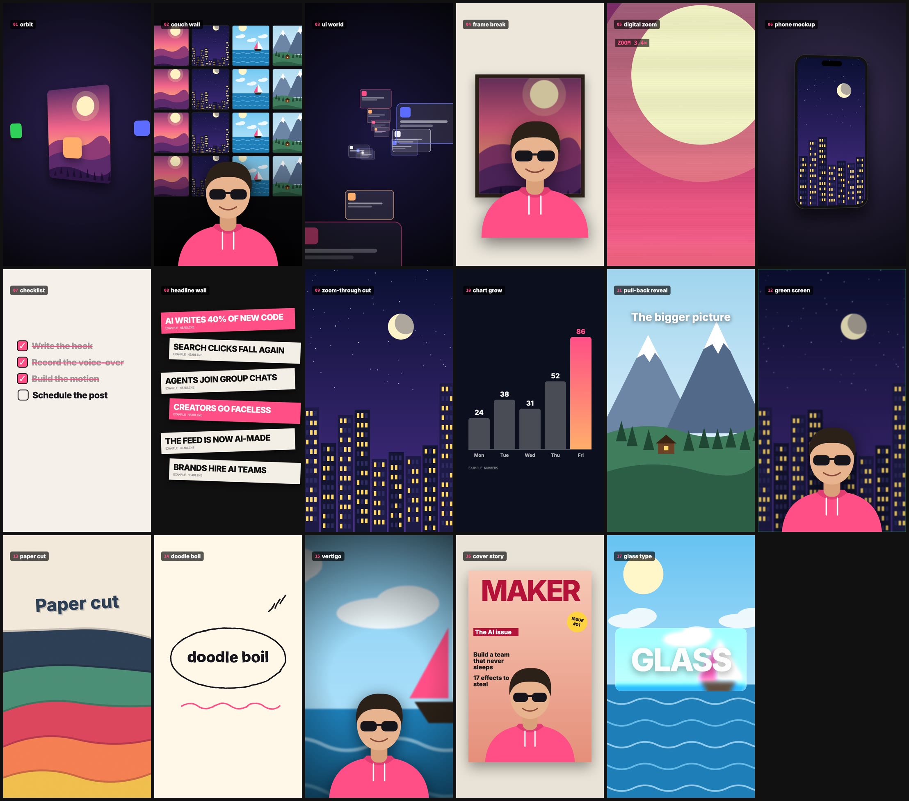

# remotion-reel-effects

17 ready-made effects for vertical videos (Reels, Shorts, TikTok), written in code for [Remotion](https://www.remotion.dev/).

Each effect is one React component. You give it your content (text, numbers, pictures) and it draws a full 1080x1920 frame. No After Effects and no templates to buy.



[Watch all 17 in 51 seconds](preview.mp4)

## The effects

| # | Component | What it does | What you can change |
| --- | --- | --- | --- |
| 01 | `Orbit` | The camera circles a card in 3D while small cards orbit it. | `src` |
| 02 | `CouchWall` | A person in front of a wall of screens that light up one by one. | `subject`, `photos` |
| 03 | `UiWorld` | Flies forward through a space full of floating interface cards. | |
| 04 | `FrameBreak` | A person starts inside a picture frame, then steps out over its border. | `subject`, `bg` |
| 05 | `DigitalZoom` | Punches in on a detail with a focus box, scanlines and a zoom readout. | `src`, `target` |
| 06 | `PhoneMockup` | Content plays inside a phone that tilts in 3D and settles. | `src`, or put your own content inside it |
| 07 | `Checklist` | Items arrive and get ticked off one by one. | `items` |
| 08 | `HeadlineWall` | Headlines slam in at an angle and stack up. | `lines`, `tag` |
| 09 | `ZoomThrough` | Zooms into a point in one picture until it becomes the next picture. | `from`, `to`, `hole` |
| 10 | `ChartGrow` | Bars grow from the baseline with counting numbers. The last bar is highlighted. | `values`, `labels`, `note` |
| 11 | `PullBack` | Starts tight on a detail, then pulls back to show the whole picture. | `src`, `detail`, `caption` |
| 12 | `GreenScreen` | The person stays put while the background behind them swaps. | `subject`, `bgs` |
| 13 | `PaperCut` | Layered paper shapes slide in with hard shadows and a paper grain. | `title` |
| 14 | `DoodleBoil` | Hand-drawn lines that wobble around a word. | `word` |
| 15 | `Vertigo` | The dolly zoom: the person stays the same size while the background stretches away. | `subject`, `bg` |
| 16 | `CoverStory` | The person becomes a magazine cover with a masthead and cover lines. | `subject`, `masthead`, `lines` |
| 17 | `GlassType` | Frosted-glass text over a moving picture, with a sheen sweeping across. | `text`, `bg` |

## Install

You need [Node.js](https://nodejs.org/) 18 or newer (tested on 24).

```bash
git clone https://github.com/umerdarazkha-debug/remotion-reel-effects
```

```bash
cd remotion-reel-effects
```

```bash
npm install
```

```bash
npm run dev
```

Remotion Studio opens in your browser. Pick **EffectsGallery** to see all 17, **Example** for a short video you can copy, or one effect from the **Single-effects** folder.

## Render a video

```bash
npm run render
```

This saves all 17 effects to `out/effects-gallery.mp4`. It took about 5 minutes on my Mac.

```bash
npm run render:example
```

This saves the 9-second example to `out/example.mp4`.

## Use an effect in your own video

Every effect takes `f`, the number of frames since that effect started. `At` hands you that number inside a sequence. This is [src/Example.tsx](src/Example.tsx):

```tsx
<Series>
  <Series.Sequence durationInFrames={90}>
    <At>{(f) => <Checklist f={f} items={["Pick one idea", "Write the hook", "Add three effects", "Render the reel"]} />}</At>
  </Series.Sequence>
  <Series.Sequence durationInFrames={90}>
    <At>{(f) => <ChartGrow f={f} values={[12, 19, 27, 41, 64]} labels={["Wk 1", "Wk 2", "Wk 3", "Wk 4", "Wk 5"]} note="SIGN-UPS PER WEEK (EXAMPLE)" />}</At>
  </Series.Sequence>
  <Series.Sequence durationInFrames={90}>
    <At>{(f) => <GlassType f={f} text="DONE" />}</At>
  </Series.Sequence>
</Series>
```

At 30 frames per second, 90 frames is 3 seconds.

**Your own pictures.** Put the image in the `public/` folder and pass its file name, or pass a full URL:

```tsx
<GlassType f={f} text="DONE" bg="photo.jpg" />
<CoverStory f={f} subject="me.png" masthead="MAKER" />
```

For `subject`, use a cut-out of the person: a roughly square PNG with a transparent background.

## With Claude Code

You don't have to write the code yourself. Open [Claude Code](https://claude.com/claude-code) in this folder and say:

```
Make a 15-second reel about my product launch. Use Checklist, ChartGrow and GlassType from src/effects.tsx, with my own text and numbers.
```

## Good to know

- **The pictures in the preview are drawings.** The scenes and the person are placeholders drawn in code (`src/placeholders.tsx`), so everything works before you add a single image. Swap in your own.
- **Example text is labelled.** The default headlines and chart numbers are made up, and say so on screen. Set `tag` or `note` to your own source, or to `""` to hide the label.
- **One size.** The effects are built for 1080x1920 at 30 frames per second. Other sizes need the numbers inside the effect changed.
- **No sound.** These are visuals only.
- **Font.** The text uses Inter, loaded from Google Fonts, so the first render needs an internet connection.
- **Remotion's licence.** Remotion is free for individuals and small teams and paid for larger companies. Check [remotion.dev/license](https://www.remotion.dev/license) before using it at work.

## Credit

The list of 17 effect ideas comes from a reel by [@tenfoldmarc](https://www.instagram.com/tenfoldmarc/), "17 video effects Claude can create". The code here is my own version of each idea, written with Claude Code from the effect names. It uses none of his files and will look different from his.

## License

MIT. Use it, change it, share it.

Built by [Umer Daraz Khan](https://github.com/umerdarazkha-debug) with Claude Code. More at [@umer.does.ai](https://www.instagram.com/umer.does.ai/) and [YouTube](https://www.youtube.com/@umerdoesai).
